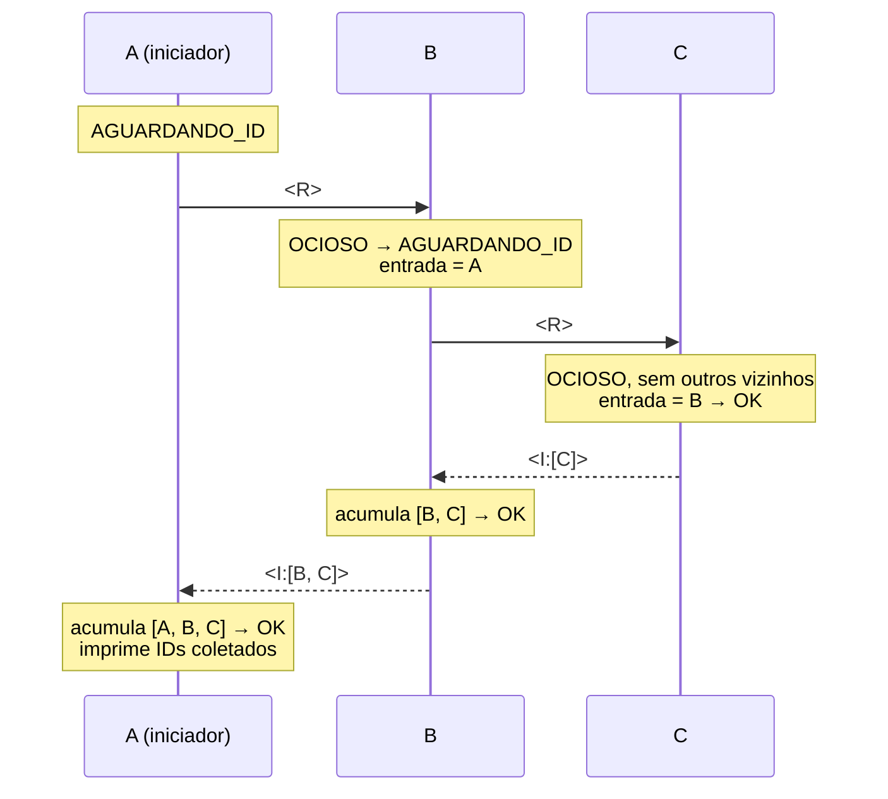

# Coleta de IDs em Sistema Distribuído (Echo / Onda de Propagação)

Especificação em pseudocódigo de um algoritmo distribuído em que um nó **iniciador** dispara uma onda de mensagens pela rede e, ao final, coleta os **IDs de todos os nós**. Também inclui dois procedimentos auxiliares, `retornar()` e `visita()`, para o controle do retorno e da visita aos vizinhos.

> Notação: `N(x)` é o conjunto de vizinhos do nó `x`, `id` é o identificador do nó e `origem` é o vizinho de quem a mensagem foi recebida.

---

## Rodar o código
```
# Nos
python3 waves.py a b d
python3 waves.py b c d a
python3 waves.py c e b d
python3 waves.py d a b e
python3 waves.py e c d

# Starter
python3 starter.py go a
```


## Sumário

- [Visão geral](#visão-geral)
- [Modelo](#modelo)
- [Mensagens](#mensagens)
- [Variáveis](#variáveis)
- [Algoritmo](#algoritmo)
  - [Estado INICIADOR](#estado-iniciador)
  - [Estado OCIOSO](#estado-ocioso)
  - [Estado AGUARDANDO_ID](#estado-aguardando_id)
- [Procedimentos auxiliares](#procedimentos-auxiliares)
  - [retornar()](#retornar)
  - [visita()](#visita)
- [Funcionamento passo a passo](#funcionamento-passo-a-passo)

---

## Visão geral

1. O iniciador envia `<R>` para todos os vizinhos.
2. Cada nó que recebe `<R>` pela primeira vez guarda a `origem` como `entrada` e repassa `<R>` aos demais vizinhos.
3. Quando um nó já recebeu uma mensagem de todos os seus vizinhos, ele envia de volta (para a `entrada`) uma mensagem `<I:info_acumulada>` com os IDs que reuniu.
4. Quando o iniciador recebe tudo, ele imprime os IDs coletados e termina.

---

## Modelo

```text
Estados    = { INICIADOR, OCIOSO, AGUARDANDO_ID, OK }
SINI       = { INICIADOR, OCIOSO }      // estados iniciais
SFIM       = { OK }                     // estado final
Restrições = R ∪ { TR, CN, BL, UI }
```

| Símbolo | Significado |
|---------|-------------|
| `SINI`  | Conjunto de estados iniciais possíveis de um nó |
| `SFIM`  | Conjunto de estados finais (terminação) |
| `R`     | Restrições básicas do modelo |
| `TR`    | Total Reliability — não há falhas de comunicação/nós |
| `CN`    | Connectivity — a rede é conexa |
| `BL`    | Bidirectional Links — os enlaces são bidirecionais |
| `UI`    | Unique Initiator — existe um único iniciador |

---

## Mensagens

| Mensagem | Descrição |
|----------|-----------|
| `<R>` | Mensagem de requisição/propagação da onda |
| `<I:dados>` | Mensagem de resposta carregando IDs (`dados`) coletados |
| `<OK + Id>` | Mensagem de confirmação de término, usada em `visita()` |

---

## Variáveis

| Variável | Descrição |
|----------|-----------|
| `estado` | Estado atual do nó |
| `iniciador` | `True` se o nó é o iniciador, `False` caso contrário |
| `entrada` | Vizinho de quem o nó recebeu `<R>` pela primeira vez |
| `contador` | Quantidade de mensagens recebidas até o momento |
| `info_acumulada` | Lista de IDs coletados (começa com o `id` do próprio nó) |

---

## Algoritmo

### Estado INICIADOR

```text
INICIADOR
  Espontaneamente
    iniciador = True
    estado = AGUARDANDO_ID
    contador = 0
    info_acumulada = [id]
    envia <R> a N(x)

    se contador == N(x):
      estado = OK
      imprime("Aplicativo Terminado. IDs coletados: ", info_acumulada)
    fimse
```

### Estado OCIOSO

```text
OCIOSO
  Recebendo <R> de origem
    iniciador = False
    estado = AGUARDANDO_ID
    entrada = origem
    contador = 1
    info_acumulada = [id]

    // Repassa a mensagem da origem para todos os vizinhos EXCETO a entrada
    vizinhos_restantes = N(x) - {origem}
    se vizinhos_restantes != { }:
      envia <R> a N(x) - { origem }
    fimse
```

### Estado AGUARDANDO_ID

```text
AGUARDANDO_ID
  Recebendo <R> ou <I:dados> de origem
    contador = contador + 1

    se mensagem for do tipo <I:dados>:
      adiciona dados recebidos a info_acumulada
    fimse

    se contador = N(x):
      estado = OK
      se iniciador == True:
        imprime("Aplicativo Terminado. IDs coletados: ", info_acumulada)
      senao:
        envia <I:info_acumulada> a entrada
      fimse
    fimse
```

---

## Procedimentos auxiliares

### retornar()

```text
Procedimento retornar()
  msg = list(msg)
  msg >> "ok"
  se vizinhos != None:
    vizinhos = vizinhos - origem
    mensagem = msg
  fimse
  senão:
    estado = OK
    se origem = id:
      mensagem = mensagem + id
      print()
    fimse
    senão:
      envia <mensagem> a {origem}
    fimse
```

### visita()

```text
Procedimento visita()
  se msg == None:
    vizinhos = N(x)
    envia <R> a N(x)
  fimse

  se msg == R:
    se origem_atual in vizinhos:
      vizinhos = vizinhos - {origem_atual}
      envia <R> a origem_atual
    fimse
  fimse

  se vizinhos == None:
    estado = OK
    envia <OK + Id> a origem
  fimse
```

---

## Funcionamento passo a passo



1. **A** (iniciador) vai para `AGUARDANDO_ID` e envia `<R>` aos vizinhos.
2. **B** (`OCIOSO`) recebe `<R>`, define `entrada = A` e repassa `<R>` a **C**.
3. **C** não tem outros vizinhos além de B, então envia `<I:[C]>` de volta.
4. **B** acumula `[B, C]` e, ao receber de todos os vizinhos, envia `<I:[B, C]>` para **A**.
5. **A** junta tudo, vai para `OK` e imprime os IDs coletados.
